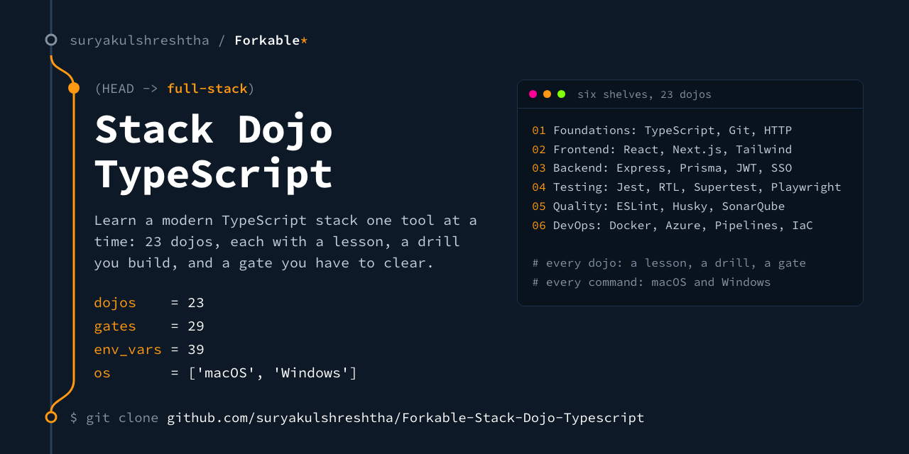

<!-- forkable-card:start (added by apply_cards.py; re-run it to update) -->

<!-- forkable-card:end -->

# 🥋 Forkable Stack Dojo: TypeScript

**Learn a modern TypeScript stack one tool at a time — twenty-three self-contained dojos, each with a lesson, a drill you build, and a gate you have to clear before you move on.**

[](LICENSE)
[](https://nodejs.org/en/about/previous-releases)
[](https://www.typescriptlang.org/docs/)
[](docs/01-workstation-setup.md)

> 🎯 **Who this is for.** You can read code but you have never set up the whole stack yourself. You want to *understand* each tool, not copy a boilerplate. Every page assumes you know nothing about the tool it teaches, and nothing about your own machine.
>
> 🧰 **What this is not.** Not one big app. Each folder stands alone — delete the twenty-two you do not care about and the one you kept still runs.

---

## 📑 Contents

| # | Where | What you will find |
|---|---|---|
| 1 | [🧠 The mental model](#-1-the-mental-model) | What a "stack" actually is, in one picture |
| 2 | [🗺 The twenty-three dojos](#-2-the-twenty-three-dojos) | The map. Every folder, what it teaches, how long |
| 3 | [⚡ Quick start](#-3-quick-start-15-minutes) | From zero to a running drill, macOS and Windows |
| 4 | [📦 The stack, pinned](#-4-the-stack-pinned-and-checked) | Every tool, its exact version, its official docs |
| 5 | [⚠️ Three things that changed](#%EF%B8%8F-5-three-things-that-changed-read-this) | Deprecations this repo refuses to teach silently |
| 6 | [🚪 How a gate works](#-6-how-a-gate-works) | The rule that stops you fooling yourself |
| 7 | [📚 Every guide in `docs/`](#-7-every-guide-in-docs) | Setup, PATH, env files, making your own repo |
| 8 | [🧾 How this repo stays honest](#-8-how-this-repo-stays-honest) | What was checked, when, and by what method |

---

## 🧠 1. The mental model

A "stack" sounds like one thing. It is really **four jobs**, and every tool below does exactly one of them. Learn the job first; the tool is then just syntax.

```
   👤 a person clicks something
             │
             ▼
 ┌───────────────────────────┐
 │ 🎨 FRONTEND               │  React, Next.js, Tailwind, shadcn/ui, Jotai
 │    draw it, hold what     │  "what does the human see, and what does
 │    the screen remembers   │   this screen remember while they use it?"
 └─────────────┬─────────────┘
               │  HTTP request  (JSON over the network)
               ▼
 ┌───────────────────────────┐
 │ ⚙️ BACKEND                │  Express, JWT, MSAL/Entra, Swagger
 │    decide, authorise,     │  "is this person allowed, and what is
 │    answer                 │   the honest answer?"
 └─────────────┬─────────────┘
               │  SQL query
               ▼
 ┌───────────────────────────┐
 │ 🗄 DATA                    │  Prisma → Azure SQL / SQL Server
 │    remember it after      │  "what is still true tomorrow?"
 │    everyone goes home     │
 └───────────────────────────┘

 Wrapped around all three, at every moment:
 ┌───────────────────────────┐   ┌───────────────────────────┐
 │ 🧪 PROOF                   │   │ 🚢 DELIVERY                │
 │ Jest, RTL, Supertest,     │   │ Docker, Azure Container    │
 │ Playwright, ESLint, Sonar │   │ Apps, Pipelines, PowerShell│
 │ "does it still work?"     │   │ "does it run anywhere but  │
 │                           │   │  your laptop?"             │
 └───────────────────────────┘   └───────────────────────────┘
```

🔑 **The one sentence to keep:** the frontend *asks*, the backend *decides*, the database *remembers*, the tests *prove*, and delivery *moves it off your machine*. Every tool in this repo is one of those five verbs.

---

## 🗺 2. The twenty-three dojos

Each folder is a dojo: a `README.md` lesson, a drill you build yourself, and a gate. Work top to bottom, or jump straight to the one you need.

### 🧱 `01-foundations/` — before you touch a framework

| Dojo | Teaches | Time |
|---|---|---|
| [`typescript/`](01-foundations/typescript/README.md) | Types, interfaces, generics, utility types, `strict` mode, and what TypeScript 7's Go compiler changed | 4–6 h |
| [`git-workflows/`](01-foundations/git-workflows/README.md) | Branch, commit, rebase, resolve a conflict on purpose, open a PR | 2–3 h |
| [`http-fundamentals/`](01-foundations/http-fundamentals/README.md) | Methods, status codes, headers, REST shape — written with Node's own `http` module, no framework | 2 h |

### 🎨 `02-frontend/` — what the human sees

| Dojo | Teaches | Time |
|---|---|---|
| [`react/`](02-frontend/react/README.md) | Components, props, `useState`, `useEffect`, `useMemo`, a custom hook, and *why* re-renders happen | 5–7 h |
| [`nextjs-app-router/`](02-frontend/nextjs-app-router/README.md) | App Router, layouts, route groups `(app)` / `(auth)`, Server vs Client Components, middleware | 6–8 h |
| [`component-library/`](02-frontend/component-library/README.md) | shadcn/ui + Radix primitives: a form, a table, a dialog, and why "copy the component in" beats a dependency | 3–4 h |
| [`tailwind/`](02-frontend/tailwind/README.md) | Utility-first CSS, the v4 CSS-first config, responsive and dark variants | 2–3 h |
| [`state-management/`](02-frontend/state-management/README.md) | The atomic model: Jotai for new code, Recoil's API for the archived code you will inherit | 3–4 h |

### ⚙️ `03-backend/` — what decides

| Dojo | Teaches | Time |
|---|---|---|
| [`express/`](03-backend/express/README.md) | Routing, middleware chains, the four-argument error handler, Express 5's async behaviour | 4–5 h |
| [`prisma-azuresql/`](03-backend/prisma-azuresql/README.md) | Schema modelling, migrations, type-safe queries, against SQL Server in Docker *or* Azure SQL | 5–7 h |
| [`jwt-auth/`](03-backend/jwt-auth/README.md) | Sign, verify, expire and refresh a token; where to store it; RBAC middleware | 4–5 h |
| [`sso-entra-msal/`](03-backend/sso-entra-msal/README.md) | Enterprise sign-in with Microsoft Entra ID using MSAL Node (and why not `passport-azure-ad`) | 4–6 h |
| [`swagger-openapi/`](03-backend/swagger-openapi/README.md) | Describe your API in OpenAPI, serve it at `/api-docs`, keep it honest | 2–3 h |

### 🧪 `04-testing/` — what proves it

| Dojo | Teaches | Time |
|---|---|---|
| [`jest/`](04-testing/jest/README.md) | Unit tests, mocks, spies, fake timers, and what *not* to mock | 3–4 h |
| [`react-testing-library/`](04-testing/react-testing-library/README.md) | Query by role, test behaviour not implementation, `userEvent` | 3–4 h |
| [`supertest/`](04-testing/supertest/README.md) | Fire real HTTP requests at your Express app with no server running | 2–3 h |
| [`playwright/`](04-testing/playwright/README.md) | One real browser journey, traces, fixtures, and why E2E count should stay small | 4–5 h |

### 🧹 `05-quality/` — what stops the bleeding

| Dojo | Teaches | Time |
|---|---|---|
| [`eslint-husky/`](05-quality/eslint-husky/README.md) | ESLint 10 flat config, Prettier, a pre-commit hook, and `--max-warnings=0` as law | 2–3 h |
| [`sonarqube/`](05-quality/sonarqube/README.md) | Static analysis locally, what a "code smell" is, and reading a quality gate | 2 h |

### 🚢 `06-devops/` — what gets it off your laptop

| Dojo | Teaches | Time |
|---|---|---|
| [`docker-multistage/`](06-devops/docker-multistage/README.md) | Images, layers, a multi-stage build, non-root containers, `.dockerignore` | 4–5 h |
| [`azure-container-apps/`](06-devops/azure-container-apps/README.md) | Push to a registry, deploy a container, scale to zero, read logs | 4–5 h |
| [`azure-pipelines/`](06-devops/azure-pipelines/README.md) | `verify → build → deploy` as YAML, with a GitHub Actions translation beside it | 3–4 h |
| [`powershell-iac/`](06-devops/powershell-iac/README.md) | Infrastructure as code, and what "idempotent" means in practice | 3–4 h |

📈 Track yourself in [PROGRESS.md](PROGRESS.md).

---

## ⚡ 3. Quick start (15 minutes)

You need exactly two things to begin: **Node 26** and **Git**. Everything else is installed by the dojo that needs it.

🧒 **Never used a terminal before?** Open [`docs/01-workstation-setup.md`](docs/01-workstation-setup.md) instead — it starts with "what is a terminal" and does not assume a single thing.

### Step 1 · Open a terminal

| 🍎 macOS | 🪟 Windows |
|---|---|
| Press `⌘ Space`, type `Terminal`, press `Return` | Press the `Windows` key, type `PowerShell`, press `Enter` |

### Step 2 · Check what you already have

Run both lines. If either says "command not found" or "not recognized", you need the install guide.

| 🍎 macOS (Terminal) | 🪟 Windows (PowerShell) |
|---|---|
| `node --version` | `node --version` |
| `git --version` | `git --version` |

✅ You want `v26.x.x` or newer from the first line, and any version from the second.
❌ Anything else → [`docs/01-workstation-setup.md`](docs/01-workstation-setup.md).

### Step 3 · Get the code

| 🍎 macOS (Terminal) | 🪟 Windows (PowerShell) |
|---|---|
| `cd ~/Desktop` | `cd $HOME\Desktop` |
| `git clone https://github.com/suryakulshreshtha/Forkable-Stack-Dojo-Typescript.git` | `git clone https://github.com/suryakulshreshtha/Forkable-Stack-Dojo-Typescript.git` |
| `cd Forkable-Stack-Dojo-Typescript` | `cd Forkable-Stack-Dojo-Typescript` |

### Step 4 · Pick your first dojo

| If you... | Start here |
|---|---|
| 🧒 have never written TypeScript | [`01-foundations/typescript/`](01-foundations/typescript/README.md) |
| 🎨 know TS, want the frontend | [`02-frontend/react/`](02-frontend/react/README.md) |
| ⚙️ know React, want the API | [`03-backend/express/`](03-backend/express/README.md) |
| 🧪 can build but cannot prove it | [`04-testing/jest/`](04-testing/jest/README.md) |
| 🚢 can build but cannot ship it | [`06-devops/docker-multistage/`](06-devops/docker-multistage/README.md) |

Every dojo README opens with its own install line, its own `.env` instructions (if it needs one) and its own gate. Nothing is assumed to be already set up.

---

## 📦 4. The stack, pinned and checked

Every version below was read from the **npm registry** or the **Node.js release schedule** on **2026-11-18**. Method and raw output: [VERSIONS.md](VERSIONS.md) · [SOURCES.md](SOURCES.md).

### 🧱 Language and runtime

| Tool | Pinned here | What it does | 📚 Official docs |
|---|---|---|---|
| Node.js | **26** (Active LTS since 2026-10-28, EOL 2029-04-30) | Runs JavaScript outside a browser | <https://nodejs.org/en/about/previous-releases> |
| TypeScript | **7.0.2** | Types on top of JavaScript; `tsc` is now a Go binary | <https://www.typescriptlang.org/docs/> |

### 🎨 Frontend

| Tool | Pinned here | What it does | 📚 Official docs |
|---|---|---|---|
| Next.js | **16.4.6** | React framework: routing, rendering, middleware | <https://nextjs.org/docs> |
| React | **19.3.1** | Builds the interface out of components | <https://react.dev/learn> |
| Tailwind CSS | **4.3.5** | Styling with utility classes | <https://tailwindcss.com/docs> |
| shadcn/ui (CLI) | **4.23.0** | Copies accessible components *into* your repo | <https://ui.shadcn.com/docs> |
| Radix UI | **1.3.1** (`react-dialog`) | The unstyled, accessible primitives underneath | <https://www.radix-ui.com/primitives/docs/overview/introduction> |
| Jotai | **3.0.2** | Atomic shared state (the maintained one) | <https://jotai.org/docs/introduction> |

### ⚙️ Backend and data

| Tool | Pinned here | What it does | 📚 Official docs |
|---|---|---|---|
| Express | **5.3.0** | HTTP routing and middleware | <https://expressjs.com/en/5x/api.html> |
| Prisma | **7.10.1** (CLI + client) | Schema, migrations, type-safe queries | <https://www.prisma.io/docs> |
| `mssql` driver | **12.7.14** | Raw SQL Server / Azure SQL connections | <https://learn.microsoft.com/en-us/azure/azure-sql/> |
| `jsonwebtoken` | **9.0.3** | Signs and verifies JWTs (RFC 7519) | <https://datatracker.ietf.org/doc/html/rfc7519> |
| Passport | **0.7.0** | Local username/password strategy | <https://www.passportjs.org/concepts/authentication/strategies/> |
| MSAL Node | **7.2.2** | Microsoft Entra ID sign-in (replaces `passport-azure-ad`) | <https://learn.microsoft.com/en-us/entra/identity-platform/> |
| `swagger-ui-express` | **5.0.1** | Serves your OpenAPI spec as a page | <https://swagger.io/specification/> |
| `swagger-jsdoc` | **6.3.0** | Builds that spec from code comments | <https://swagger.io/docs/specification/v3_0/about/> |
| Zod | **4.6.7** | Validates incoming request bodies | <https://zod.dev> |

### 🧪 Proof

| Tool | Pinned here | What it does | 📚 Official docs |
|---|---|---|---|
| Jest | **30.5.2** | Unit and integration test runner | <https://jestjs.io/docs/getting-started> |
| `@testing-library/react` | **16.3.3** | Tests components the way a user meets them | <https://testing-library.com/docs/react-testing-library/intro/> |
| Supertest | **7.3.2** | HTTP assertions against an Express app | <https://github.com/ladjs/supertest> |
| Playwright | **1.65.1** | Real-browser end-to-end tests | <https://playwright.dev/docs/intro> |
| ESLint | **10.15.0** | Finds bad patterns before review does | <https://eslint.org/docs/latest/> |
| Prettier | **3.10.1** | Formats so nobody argues about it | <https://prettier.io/docs/> |
| Husky | **9.1.7** | Runs checks on `git commit` | <https://typicode.github.io/husky/> |
| lint-staged | **17.6.1** | Lints only what you staged | <https://github.com/lint-staged/lint-staged> |
| SonarQube | Server/Cloud/Community Build | Static analysis and a quality gate | <https://docs.sonarsource.com/> |

### 🚢 Delivery

| Tool | Pinned here | What it does | 📚 Official docs |
|---|---|---|---|
| Docker | latest stable | Packages the app with its dependencies | <https://docs.docker.com/build/building/multi-stage/> |
| Azure Container Apps | n/a (service) | Runs that container, scales it to zero | <https://learn.microsoft.com/en-us/azure/container-apps/> |
| Azure Pipelines | n/a (service) | `verify → build → deploy` on every merge | <https://learn.microsoft.com/en-us/azure/devops/pipelines/> |
| PowerShell | 7.x | Scripts that create the cloud resources | <https://learn.microsoft.com/en-us/powershell/> |

---

## ⚠️ 5. Three things that changed — read this

This repo was written on 2026-11-18. Three tools that a 2024-era tutorial would hand you are **no longer the right answer**, and this repo says so out loud rather than teaching them quietly.

| ❌ What tutorials still say | ✅ What this repo does | 🔍 How it was checked |
|---|---|---|
| "Use **Recoil** for shared state" | Teaches the atomic model with **Jotai 3.0.2**, and shows Recoil's API only so you can read code that already uses it | Meta archived `facebookexperimental/Recoil` on **2025-01-01**; last npm publish **2024-02-12** (`recoil@0.7.7`) |
| "Use **`passport-azure-ad`** for Microsoft SSO" | Teaches **MSAL Node 7.2.2**; Passport stays for the local username/password strategy only | npm reports the package as **deprecated**, pointing to Microsoft's replacement guidance |
| "Use **Ant Design** for components" | Teaches **shadcn/ui + Radix**, which copy source into your repo instead of adding a dependency | Chosen deliberately for this repo; Ant Design is maintained, this is a stack decision, not a deprecation |

🧠 **Also worth knowing:** `npm install prisma` may pull an **8.0 release candidate** (the registry's `next` tag was `8.0.0-rc.10` on 2026-11-18). Every dojo here pins `prisma@7.10.1` on purpose. And `tsc` is now a **Go binary** (TypeScript 7.0, stable July 2026) — type-checking is roughly 8–12× faster, but compiler *transformer plugins* do not work with it.

---

## 🚪 6. How a gate works

Every dojo ends with a **gate**: one sentence describing something you can *do*, not something you have read.

```
 📖 read the lesson   →   🛠 build the drill   →   🚪 clear the gate   →   ➡️ next dojo
                                   ▲                      │
                                   └──── not yet? ────────┘
```

| 🚫 Not a gate | ✅ A gate |
|---|---|
| "I watched a video on middleware" | "I can write an Express error handler that turns any thrown error into a JSON response with the right status code, from an empty file, without looking it up" |
| "I understand Docker" | "I can explain, line by line, why my image is 180 MB instead of 1.2 GB" |

🙅 **The rule:** if you cannot do the gate from an empty file, you have not finished the dojo. Nobody is checking. That is exactly why it works.

---

## 📚 7. Every guide in `docs/`

| Guide | Read it when | Assumes |
|---|---|---|
| [`00-what-this-repo-is.md`](docs/00-what-this-repo-is.md) | First. Five minutes. | Nothing |
| [`01-workstation-setup.md`](docs/01-workstation-setup.md) | Your machine is empty, or `node --version` failed | You have never opened a terminal |
| [`02-path-explained.md`](docs/02-path-explained.md) | Something is "installed" but "not found" | Nothing. Starts at "what is PATH" |
| [`03-env-files-and-secrets.md`](docs/03-env-files-and-secrets.md) | Any dojo tells you to create a `.env` | Nothing. Every variable in this repo is listed |
| [`04-create-a-repo-from-scratch.md`](docs/04-create-a-repo-from-scratch.md) | You want your *own* repo like this one, start to finish | Git is installed |
| [`05-git-daily-driver.md`](docs/05-git-daily-driver.md) | You are mid-mess and need the way out | Git is installed |
| [`06-troubleshooting.md`](docs/06-troubleshooting.md) | Any error message at all | Nothing |

---

## 🧾 8. How this repo stays honest

| 🔔 Claim type | 🧪 How it is handled |
|---|---|
| **Version numbers** | Read from the npm registry (`npm view <pkg> version`) and the Node.js release schedule JSON on 2026-11-18. Raw output in [VERSIONS.md](VERSIONS.md) |
| **Deprecations** | Verified against the package's own npm metadata and its repository's archive status, both cited in [VERSIONS.md](VERSIONS.md) |
| **Commands** | Written for Node 26 on macOS (zsh) and Windows (PowerShell). Where they differ, both are shown side by side — never one with a vague note |
| **Documentation links** | Point at official project or vendor documentation only. Blog posts appear in [REFERENCES.md](REFERENCES.md), labelled as such, never as a source of fact |
| **Anything unverified** | Says so in the sentence, in brackets. If this repo does not know, it does not guess |

🔁 **Re-check before you trust.** Versions move. Run `npm outdated` in any dojo you have installed, and re-read [VERSIONS.md](VERSIONS.md) — it records the date every number was last confirmed.

---

## 🤝 Contributing, licence, security

* 🛠 [CONTRIBUTING.md](CONTRIBUTING.md) — how to add a dojo, and the one rule every lesson must follow
* 🔐 [SECURITY.md](SECURITY.md) — never commit a `.env`; what to do if you already did
* ⚖️ [LICENSE](LICENSE) — Apache-2.0
* 📖 [SOURCES.md](SOURCES.md) — every official document this repo relies on

> *⭐ If a dojo saves you an afternoon, a star helps someone else find it.*
